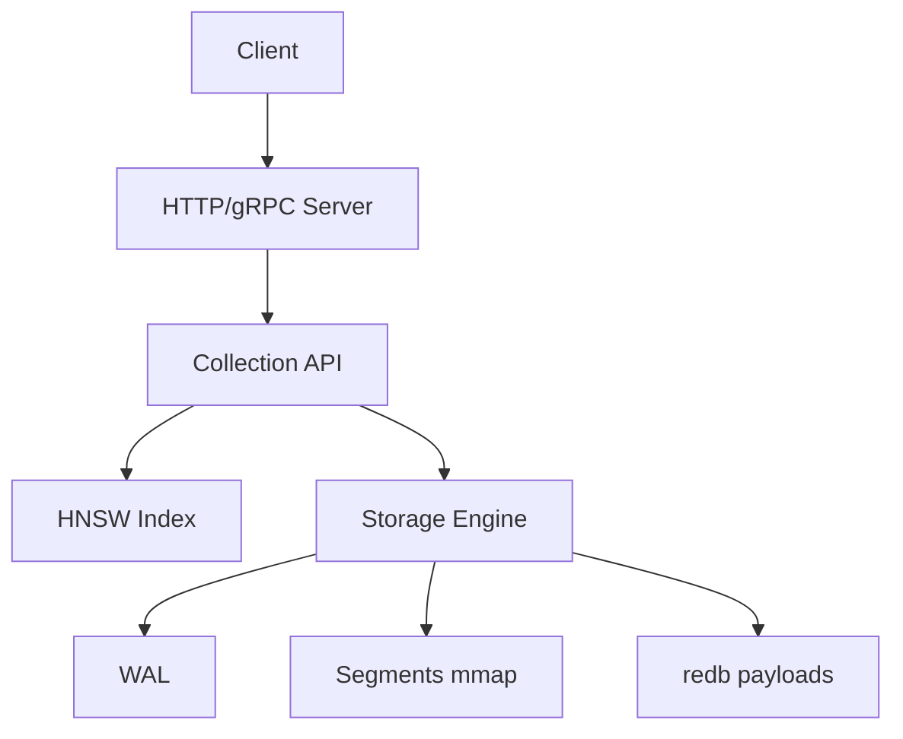

# vectordb


Embedded vector search engine in Rust (HNSW, durable, filtered search, HTTP/gRPC, Python).

## Quickstart (library)

```rust
use vectordb_core::collection::Collection;
use vectordb_core::index::HnswParams;
use vectordb_core::storage::FsyncPolicy;
use std::path::Path;
let mut c = Collection::create(Path::new("./data"), "c".into(), 2, vectordb_core::distance::Metric::L2, HnswParams::default(), FsyncPolicy::None).unwrap();
c.upsert(1, vec![0.0,0.0], None).unwrap();
```

## Server

```
cargo run -p vectordb-server
```

## Python

```
maturin develop
```

## Architecture



See docs/ARCHITECTURE.md.
EOF